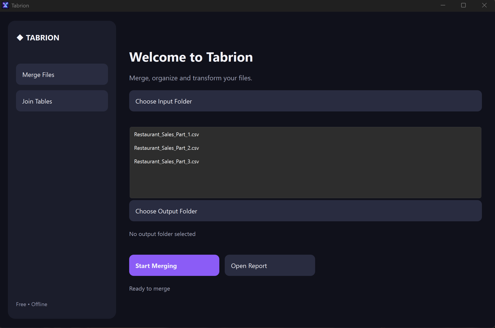
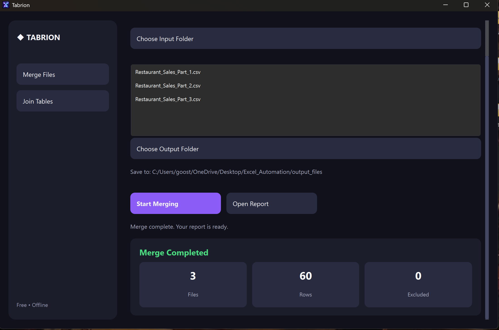
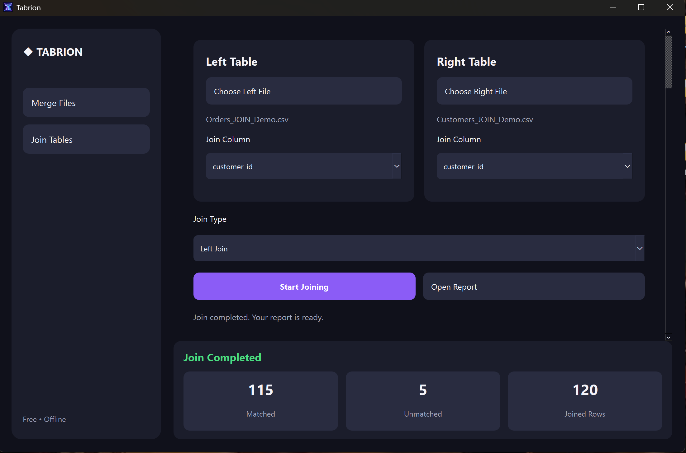
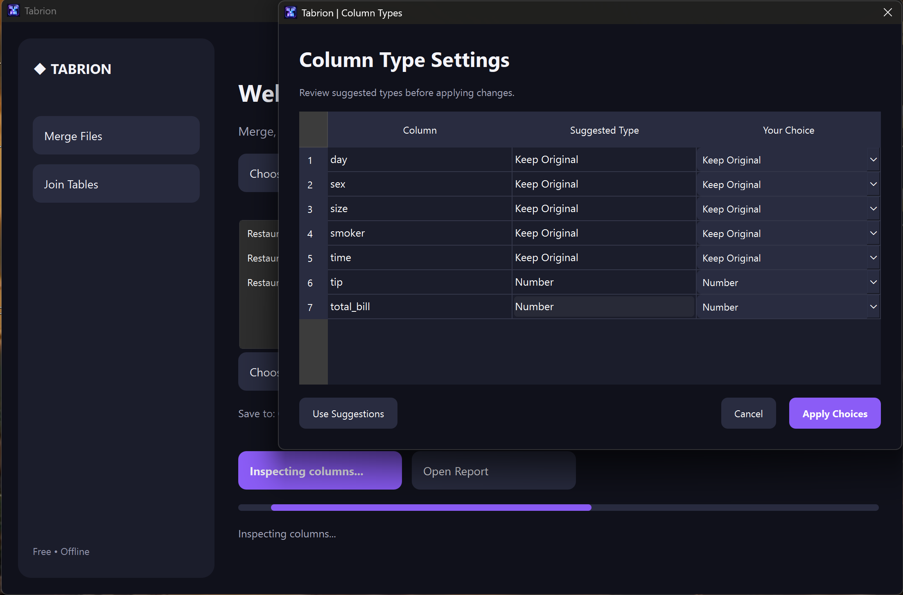

# Tabrion

**Merge files. Join tables. Simplify data preparation.**

Tabrion is a free Windows desktop application for combining Excel and CSV files, joining related tables, and preparing spreadsheet data without writing code.


[](https://github.com/Hussain-007M/Tabrion/actions/workflows/tests.yml)

> **Available on Microsoft Store:** [Get Tabrion for Windows](https://apps.microsoft.com/detail/9N3JNHRFQ9BL). Tabrion v3.4.1.0 passed Microsoft Store certification and was published in October 2026.

## Screenshots

### Welcome to Tabrion



### Merge files and join tables

| Merge completed | Join completed |
| --- | --- |
|  |  |

### Column type settings



## Features

### Merge Files
- Combine multiple CSV and XLSX files from a selected folder.
- Review suggested column types before processing.
- Export the merged data to an Excel workbook.
- Track processed file and row counts, and open the output report.

### Join Tables
- Join two Excel or CSV datasets by matching key columns.
- Choose **Left Join** or **Inner Join**.
- See matched, unmatched, and joined-row counts.
- Detect duplicate right-side join keys to reduce unexpected row multiplication.
- Leave the original source files unchanged.

**Merge** appends rows from multiple datasets. **Join** connects related records using matching keys.

## Technology

**Python** · **PySide6** · **pandas** · **openpyxl** · **pytest** · **PyInstaller** · **MSIX**

## Run from source

On Windows with Python installed:

```powershell
python -m pip install -r requirements.txt
python modern_gui.py
```

## Run automated tests

```powershell
python -m pip install pytest
python -m pytest -q test_data_types.py test_type_suggestions.py test_merge_integration.py test_join_engine.py
```

The project has **22 passing automated tests** as of October 2026. Testing covers data types, suggestions, merging, and joining, but does not verify every production edge case.

## Distribution

Download Tabrion through the official [Microsoft Store listing](https://apps.microsoft.com/detail/9N3JNHRFQ9BL).

The [MSIX packaging workflow](https://github.com/Hussain-007M/Tabrion/actions/workflows/msix-store.yml) generates an unsigned submission artifact for Partner Center. This artifact is **not a signed installer for direct distribution**.

## Local data processing

Tabrion operates on your Windows computer. It reads spreadsheet inputs locally and saves generated reports to a user-selected output location. Source files are not uploaded to an external service during processing.

## Developer

Built and maintained by [Hussain-007M](https://github.com/Hussain-007M).
