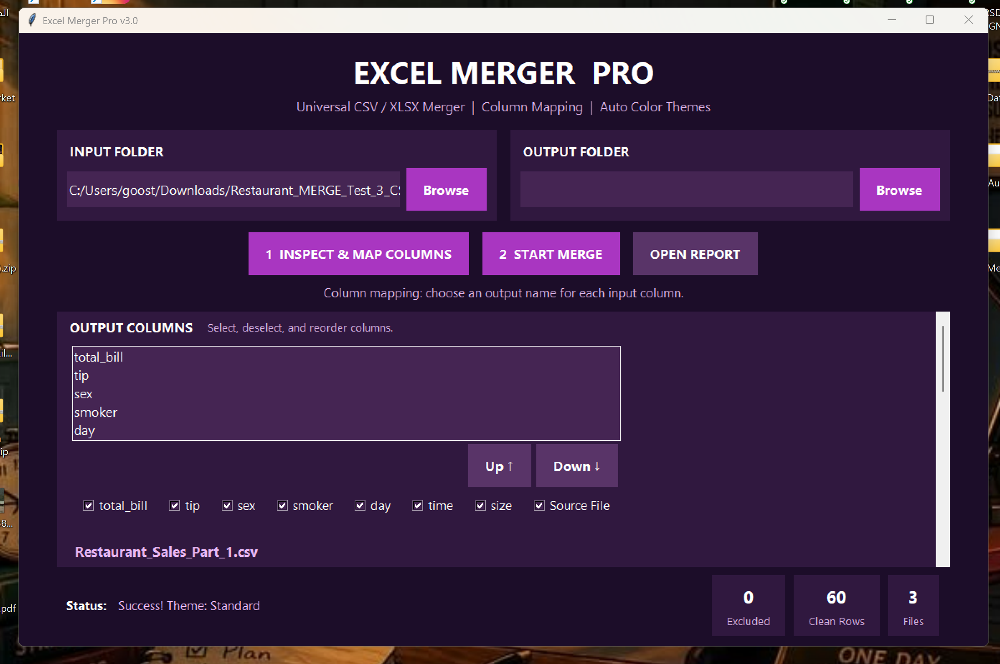
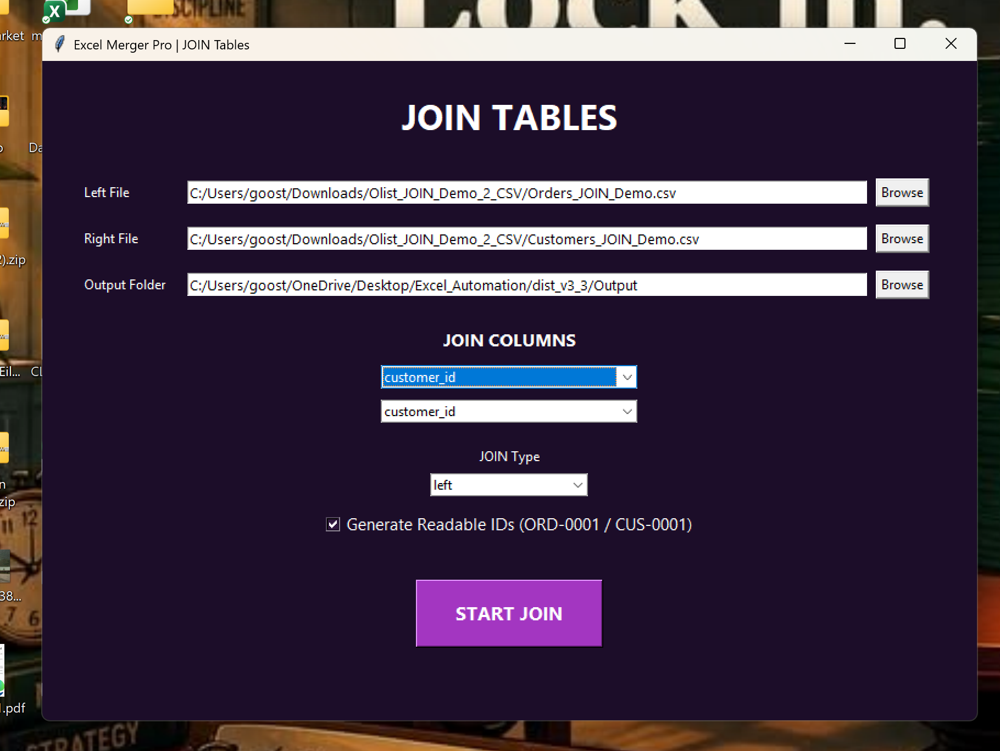
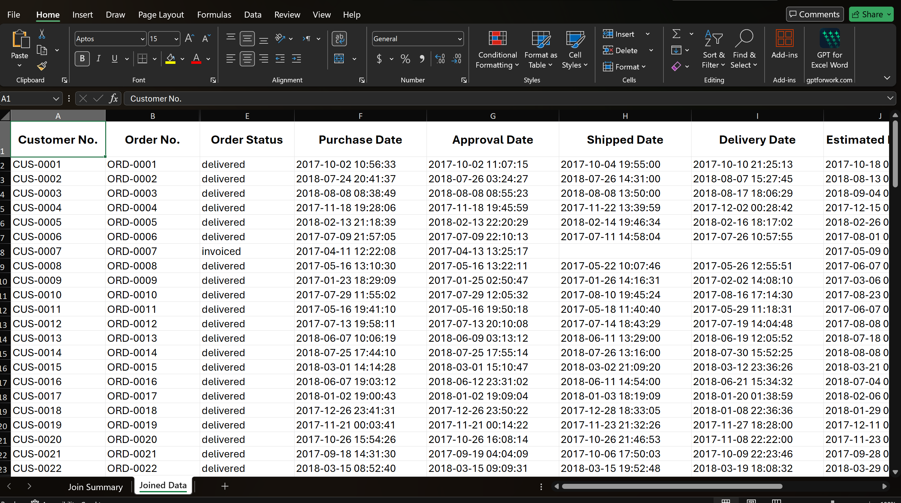

# Excel Merger Pro

A Windows desktop application for combining Excel and CSV files and joining related tables through a modern PySide6 interface.

**Project status:** Modern desktop version tested locally on Windows. The published [v3.3.0 release](https://github.com/Hussain-007M/Excel-Merger-Pro/releases/tag/v3.3.0) is an **earlier build** and does not represent the latest development branch. A new downloadable release has not been published yet.

## Features

### Merge Files
- Combine CSV and XLSX files from a selected folder.
- Inspect columns and review suggested data types before merging.
- Export an Excel workbook with a merge summary and processed rows.
- View processing counts and open the report from the interface.

### Join Tables
- Join two CSV or XLSX tables using selected key columns.
- Choose a LEFT or INNER join.
- Display matched, unmatched and joined-row counts.
- Reject duplicate keys in the right table to prevent unintended multiplication.
- Preserve the original input files. Existing identifiers are not replaced in the normal workflow.

## Merge vs Join

**Merge Files** appends rows from input files. **Join Tables** combines related records using matching key values.

## Technologies

Python, PySide6 (Qt), pandas, openpyxl, pytest, and PyInstaller.

## Run from source

On Windows, in a virtual environment:

```powershell
python -m pip install -r requirements.txt
python modern_gui.py
```

Select **Merge Files** or **Join Tables** in the sidebar. Select input data and an output folder; the application writes an Excel report to the chosen output location.

## Tests

```powershell
python -m pip install pytest
python -m pytest -q
```

The development branch has 22 locally passing tests as of October 2026. Tests cover data types, suggestions, merging, and core joining behavior. This does **not** mean all production edge cases are verified.

## Windows build

The development branch includes a PyInstaller spec for a folder-based, windowed Windows build:

```powershell
python -m PyInstaller --noconfirm --workpath "$env:TEMP\ExcelMergerPro_build" --distpath ".\dist_release" ExcelMergerPro-Release.spec
```

Run `dist_release\ExcelMergerPro-Release\ExcelMergerPro-Release.exe`, keeping the accompanying `_internal` directory intact. The folder-based build was tested locally, but should also be validated on a separate Windows machine before public distribution.

## Screenshots

Screenshots currently in the repository may show the earlier interface. Updated captures of the modern release are planned.








## Branches and releases

- `main`: previous published source and version 3.3.0 release.
- `develop/modern-desktop`: modern PySide6 interface, automated tests, and release-build configuration.
- [Releases](https://github.com/Hussain-007M/Excel-Merger-Pro/releases): downloadable builds and release notes.

**Data handling:** Source files are read for processing; output is written separately to the user-selected folder. Review joins and output columns before relying on reports for business-critical work.
